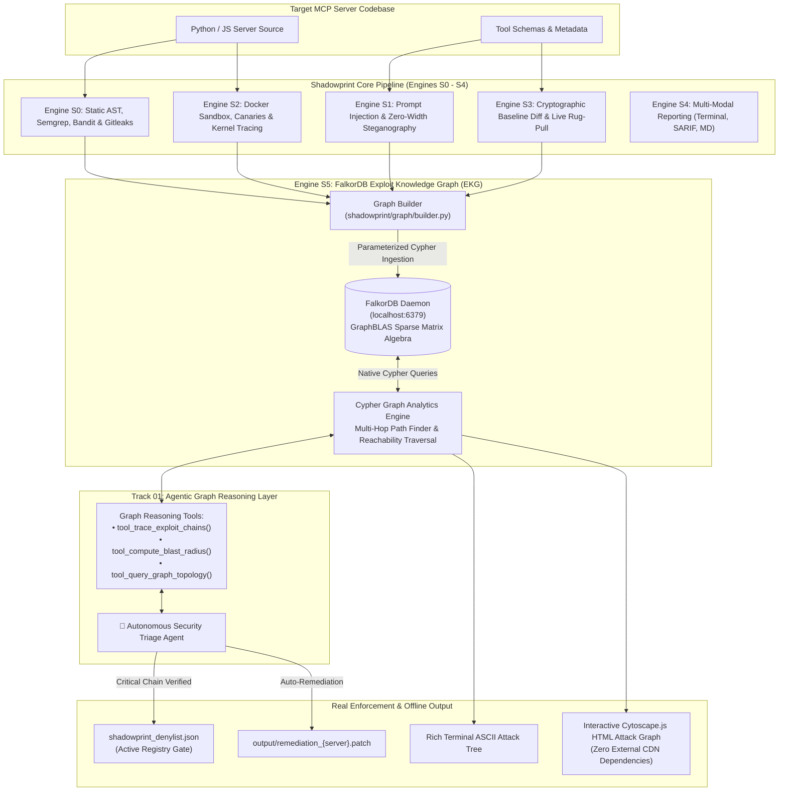

# Shadowprint — Complete Project Architecture & Structure Specification

> **Project:** Shadowprint — Model Context Protocol Security Auditor & Exploit Knowledge Graph  
> **Hackathon:** FalkorDB Hackathon 2026  
> **Track:** Track 01 — Agents That Act on Connected Data  
> **Authors & Co-Builders:** Jasjyot Singh & Gaurang Udgirkar *(OpenForge Hackathon Winners)*  
> **Target Environment:** Python 3.10–3.14, Docker Desktop (Windows / macOS / Linux), FalkorDB GraphBLAS Engine  

---

## 1. Executive Overview

**Shadowprint** is an enterprise-grade security auditing and graph intelligence platform purpose-built for **Model Context Protocol (MCP)** servers.

By integrating **FalkorDB**—the high-performance, GraphBLAS-powered graph database—Shadowprint bridges the gap between isolated vulnerability findings and **multi-hop compound exploit chains**. It deploys an autonomous **AI Triage Agent** that queries graph topologies via Cypher to reason over connected attack paths, evaluate downstream reachability blast radii, enforce registry registration blocks, and generate atomic remediation patches.

### The Five-Engine Evidence Chain:
$$\text{Metadata (S1)} \longleftrightarrow \text{Static AST (S0)} \longleftrightarrow \text{Runtime Prober (S2)} \longleftrightarrow \text{Integrity Pin (S3)} \longleftrightarrow \text{FalkorDB Exploit Graph (S5)}$$

### Core Guarantees:
1. **Graph-Native Attack Lineage (Engine S5):** All static, metadata, and dynamic findings are ingested into a unified FalkorDB graph where multi-hop exploit paths (e.g. Prompt Injection $\to$ Tool $\to$ AST Sink $\to$ Honeytoken Canary $\to$ Socket Egress) are resolved in $<1$ ms.
2. **Dual FalkorDB Mode:** Operates natively with live FalkorDB daemon (`localhost:6379`) or fully headless with an In-Memory Test Double (`--use-test-double`) for 100% offline CI/CD and evaluation.
3. **The Static Precedence Invariant:** Engine S0 static checks must pass before untrusted code or containerized runtime processes ever execute.
4. **Clean Stdio Isolation:** All auxiliary diagnostic logs (`strace`, HTTP sink, supervisor output) redirect to disk files in `/obs/` so standard I/O remains 100% pure JSON-RPC without stderr corruption.
5. **Real Enforcement & Restraint:** The Security Triage Agent writes real blocks to `shadowprint_denylist.json` and emits atomic `.patch` files when critical chains are proven, while exercising full restraint (`APPROVE_SERVER`) on clean servers.

---

## 2. High-Level Architecture Diagram



---

## 3. Exploit Knowledge Graph (EKG) Data Model

### Node Labels
| Label | Description | Primary Key | Key Properties |
| :--- | :--- | :--- | :--- |
| `:Server` | Target MCP server under audit | `server:{name}` | `name`, `version`, `status` |
| `:Tool` | Exposed MCP tool capability | `tool:{server}:{name}` | `server`, `name`, `description` |
| `:Resource` | Static/dynamic MCP resource | `resource:{server}:{name}` | `server`, `name`, `uri` |
| `:Prompt` | Server prompt template | `prompt:{server}:{name}` | `server`, `name` |
| `:Sink` | Dangerous AST function sink | `sink:{server}:{type}:{line}` | `server`, `sink_type`, `line`, `code` |
| `:Canary` | Filesystem honeytoken | `canary:{server}:{path}` | `server`, `path`, `accessed` |
| `:EgressEndpoint` | Observed external network endpoint | `egress:{server}:{dest}` | `server`, `destination`, `port` |
| `:SecurityFinding` | Normalized vulnerability finding | `finding:{server}:{id}` | `finding_id`, `engine`, `severity`, `title` |
| `:Mutation` | Temporal drift between snapshots | `mutation:{server}:{type}:{id}` | `server`, `type`, `detail` |

### Relationship Types
| Relationship | Source $\to$ Target | Description |
| :--- | :--- | :--- |
| `EXPOSES` | `(:Server) -> (:Tool\|:Resource\|:Prompt)` | Declares tool or resource exposed by server |
| `FLAGGED_BY` | `(:Tool\|:Resource) -> (:SecurityFinding)` | Links exposed element to vulnerability finding |
| `HIJACKS_CONTROL` | `(:SecurityFinding) -> (:Tool)` | Prompt injection hijacking tool execution |
| `TAINT_FLOWS_TO` | `(:Tool) -> (:Sink)` | Untrusted tool input flowing into dangerous sink |
| `READS_HONEYPOT` | `(:Sink) -> (:Canary)` | Process reading filesystem honeytoken |
| `CONNECTS_TO` | `(:Sink) -> (:EgressEndpoint)` | Process initiating outbound network connection |
| `CALLS` | `(:Tool) -> (:Tool)` | Inter-tool dependency call |
| `DETECTED_MUTATION`| `(:Mutation) -> (:Tool\|:Resource)` | Stealth drift or permission escalation |

---

## 4. Directory Structure (Clean Repository)

```text
Openforge_security_audit_falkore_version/
├── Dockerfile                                 # Root container definition for zero-setup deployment
├── docker-compose.yml                         # FalkorDB + Shadowprint App services
├── start.py                                   # Universal zero-friction runner & port manager
├── start.bat                                  # Windows one-click launcher
├── start.sh                                   # macOS / Linux one-click launcher
├── Makefile                                   # Developer workflow commands
├── README.md                                  # Project overview, quickstart & architecture
├── RUNNING.md                                 # Full execution, deployment & troubleshooting guide
├── ARCHITECTURE_AND_STRUCTURE.md              # THIS DOCUMENT: Architecture & Structure Spec
├── ENGINEERING_DECISIONS.md                   # Architectural Decision Records (ADR 001 - 013)
├── pyproject.toml                             # Package definition & CLI entrypoint
├── requirements.txt                           # Frozen exact dependencies
├── shadowprint_denylist.json                  # Enforcement registry gate store
│
├── dashboard/                                 # Interactive Web Dashboard
│   ├── index.html                             # Single-page responsive dashboard UI
│   ├── style.css                              # Modern glassmorphism CSS design system
│   ├── app.js                                 # Dynamic state manager & 7-MCP explorer
│   ├── generate_data.py                       # Pre-compiles audit reports into dashboard_data.json
│   └── dashboard_data.json                    # Bundled offline dataset
│
├── docker/                                    # Engine S2 Sandbox Assets
│   ├── Dockerfile.sandbox                     # Dynamic isolated probe container
│   ├── entrypoint.sh                          # strace supervisor
│   └── sink.py                                # Localhost HTTP silent telemetry sink
│
├── fixtures/                                  # Official Benchmark Fixtures
│   ├── clean_notes/                           # F1: Benign Notes CRUD server (0 False Positives)
│   ├── clean_fetch/                           # F1b: Benign Fetch server (0 False Positives)
│   ├── poisoned_weather/                      # F2: Unicode TAGs & Zero-Width Steganography
│   ├── vulnerable_runner/                     # F3: RCE, SSRF, Deserialization, Hardcoded Secrets
│   ├── exfil_calculator/                      # F4: Covert Markdown Image & Query Exfiltration
│   ├── rugpull_suite/                         # F5: Dynamic Post-Approval Schema Mutation
│   ├── attack_the_auditor/                    # F6: Hostile #nosec Suppression & Symlink Traps
│   └── compound_exploit_server/               # Multi-Hop Connected Exploit Showcase (Track 01)
│
├── manifest/                                  # Benchmark Expectations
│   └── shadowprint_fixture_manifest.json      # Ground truth recall expectations
│
├── output/                                    # Exported SARIF & Markdown Reports
│
├── scripts/                                   # Standalone Verification Utilities
│   ├── manual_demo.py                         # Zero-setup interactive verification harness
│   ├── test_manifest.py                       # Automated 7-fixture benchmark runner
│   └── preflight_check.py                     # Environment diagnostics
│
├── shadowprint/                               # Core Application Package
│   ├── cli.py                                 # Main CLI orchestrator
│   ├── models.py                              # Frozen Pydantic data contracts
│   ├── normalizer.py                          # Cross-engine finding deduplication
│   │
│   ├── client/                                # Guarded MCP stdio client
│   │   ├── __init__.py
│   │   └── mcp_client.py
│   │
│   ├── graph/                                 # Engine S5: FalkorDB Graph Intelligence (Track 01)
│   │   ├── client.py                          # Native FalkorDB & headless test double
│   │   ├── schema.py                          # Node labels & relationship types
│   │   ├── builder.py                         # Parameterized Cypher graph construction
│   │   ├── queries.py                         # Multi-hop traversal & blast radius queries
│   │   ├── agent.py                           # Autonomous Security Triage Agent
│   │   ├── visualizer.py                      # Standalone Cytoscape.js HTML generator
│   │   └── cli.py                             # Graph CLI subcommands (triage, chains, etc.)
│   │
│   ├── s0_static/                             # Engine S0: Static AST Analysis
│   │   ├── scanner.py                         # Orchestrator
│   │   ├── bandit_runner.py                   # Bandit AST analysis
│   │   ├── semgrep_runner.py                  # Semgrep taint rules
│   │   └── claim_code_checker.py              # Tool claim vs code validation
│   │
│   ├── s1_metadata/                           # Engine S1: Metadata Inspection
│   │   ├── analyzer.py                        # Description analysis
│   │   ├── prompt_guard.py                    # Steganography & prompt injection
│   │   └── qwen_judge.py                      # Local AI judge integration
│   │
│   ├── s2_prober/                             # Engine S2: Dynamic Probing
│   │   ├── sandbox.py                         # Container runner
│   │   ├── output_scanner.py                  # Exfiltration scanner
│   │   └── canary_tripwire.py                 # Honeytoken tripwire
│   │
│   ├── s3_integrity/                          # Engine S3: Pinning & Diffing
│   │   ├── db.py                              # SQLite 3-layer cryptographic pin store
│   │   ├── hasher.py                          # Three-layer SHA-256 calculator
│   │   ├── differ.py                          # DeepDiff with escaped unicode
│   │   └── watcher.py                         # Sub-second live polling loop
│   │
│   └── s4_reporting/                          # Engine S4: Reporting & UI
│       ├── terminal_ui.py                     # Rich console interface
│       ├── markdown_reporter.py               # Markdown report generator
│       └── sarif_exporter.py                  # OASIS SARIF 2.1.0 standard exporter
│
└── tests/                                     # Automated Test Suite (55 Passed, 100%)
```

---

## 5. Benchmark Scenarios & Ground Truth Target Recall

| ID | Fixture Directory | Planted Flaw / Attack Vector | Target Engine | Expected Audit Outcome | Owner |
|---|---|---|---|---|---|
| **F1** | `fixtures/clean_notes` | Benign notes CRUD tool | None | **0 False Positives** (CLEAN PASS) | Jasjyot |
| **F1b** | `fixtures/clean_fetch` | Benign fetch tool | None | **0 False Positives** (CLEAN PASS) | Gaurang |
| **F2** | `fixtures/poisoned_weather` | Prompt injection via Unicode TAGs (`\uE000`) | S1 (Regex + Qwen3) | Injection quote extracted & flagged `CRITICAL` | Jasjyot |
| **F3** | `fixtures/vulnerable_runner` | `subprocess.Popen(shell=True)` + hardcoded AWS key | S0 (Bandit + AST) | Exact line-level findings (CWE-78, CWE-798) | Jasjyot |
| **F4** | `fixtures/exfil_calculator` | Reads `/tmp/canary_creds.env` & sends to HTTP sink | S2 (Syscall + Sink) | `openat` & `connect` flagged `CRITICAL` exfil | Gaurang |
| **F5** | `fixtures/rugpull_suite` | Definition flips upon `/tmp/rugpull_trigger.flag` touch | S3 (Watcher + Diff) | Instant red alert in $<0.5$s with character diff | Gaurang |
| **F6** | `fixtures/attack_the_auditor` | Malicious `#nosec` / `#nosemgrep` suppression comments | S0 Scanner Hardening | Suppressions flagged as `TAMPER_ATTEMPT` | Jasjyot |
| **F7** | `fixtures/compound_exploit_server` | Multi-hop connected chain: Prompt $\to$ Tool $\to$ AST Sink | S5 (FalkorDB EKG) | Autonomous Triage Agent `BLOCK_REGISTRATION` | Jasjyot & Gaurang |

---

*Shadowprint — Built for the FalkorDB Hackathon Track 01 by Gaurang Udgirkar & Jasjyot Singh.*
