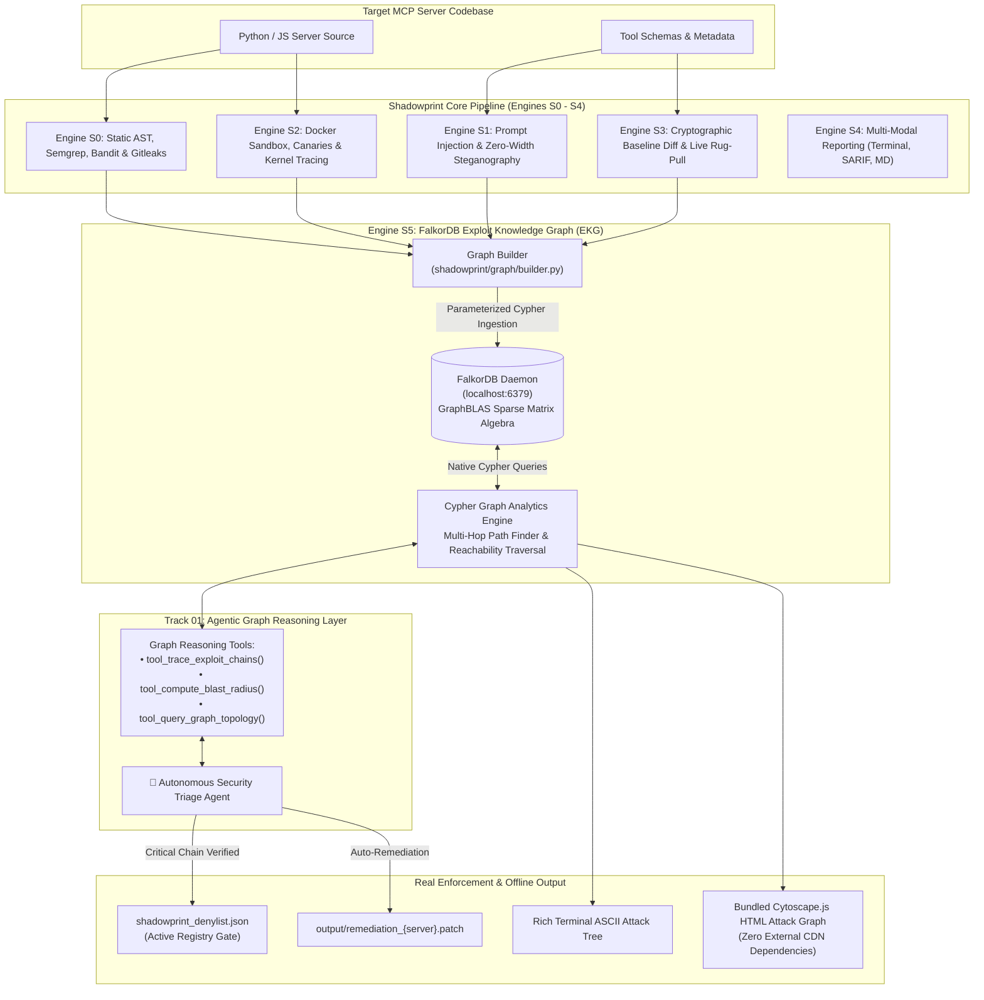

# 🕸️ SHADOWPRINT — Graph-Native MCP Security Auditor & Autonomous Triage Platform

> *"Every server leaves a trace. Every attack leaves a graph."*

[](https://github.com/Jasjyot-Singh/Openforge_security_audit_falkore_version)
[](https://github.com/Jasjyot-Singh/Openforge_security_audit_falkore_version)
[](https://github.com/Jasjyot-Singh/Openforge_security_audit_falkore_version)
[](https://github.com/Jasjyot-Singh/Openforge_security_audit_falkore_version)
[](LICENSE)

**Shadowprint** is an enterprise-grade security auditing and graph intelligence platform purpose-built for **Model Context Protocol (MCP)** servers.

By integrating **FalkorDB**—the high-performance, GraphBLAS-powered graph database—Shadowprint bridges the gap between isolated vulnerability findings and **multi-hop compound exploit chains**. It deploys an autonomous **AI Triage Agent** that queries graph topologies via Cypher to reason over connected attack paths, evaluate downstream reachability blast radii, enforce registry registration blocks, and generate atomic remediation patches.

---

## 🏆 Hackathon Track Alignment

### 🕵️ Primary Track: Track 01 — Agents That Act on Connected Data
* **Autonomous Security Triage Agent:** An agent that inspects connected graph topology using Cypher tools to evaluate risk, verify attack paths, and execute real enforcement decisions (`BLOCK_REGISTRATION`, `QUARANTINE_TOOL`, `APPROVE_SERVER`).
* **Multi-Hop Traversal Reasoning:** Resolves multi-hop exploit paths invisible to isolated, flat vulnerability scanners:
  $$\text{Prompt Injection (S1)} \xrightarrow{\text{HIJACKS\_CONTROL}} \text{Tool} \xrightarrow{\text{TAINT\_FLOWS\_TO}} \text{AST Sink (S0)} \xrightarrow{\text{READS\_HONEYPOT}} \text{Canary File} \xrightarrow{\text{CONNECTS\_TO}} \text{Egress Endpoint (S2)}$$
* **Graph Queries as Agent Tools:** Exposes graph analytics functions (`tool_trace_exploit_chains`, `tool_compute_blast_radius`, `tool_query_graph_topology`) to the agent for evidence-gated decision making.
* **Real Enforcement Action:** When a critical multi-hop chain is proven, `BLOCK_REGISTRATION` writes an entry to `shadowprint_denylist.json` and emits an atomic remediation diff (`output/remediation_{server}.patch`). The `shadowprint approve` registry gate actively checks this denylist and rejects blocked servers.
* **Demonstrated Restraint on Clean Servers:** Evaluated against clean control fixtures, the agent verifies zero exploit paths exist and explicitly concludes `APPROVE_SERVER` without alarming.

---

## 🏗️ System Architecture & Exploit Knowledge Graph (EKG)



---

## 📊 FalkorDB Graph Data Model

The Exploit Knowledge Graph schema maps the full attack surface into a unified topological model:

### Node Labels
| Label | Description | Primary Key | Key Properties |
| :--- | :--- | :--- | :--- |
| `:Server` | Target MCP server under audit | `server:{name}` | `name`, `version`, `status` |
| `:Tool` | Exposed MCP tool capability | `tool:{server}:{name}` | `server`, `name`, `description` |
| `:Resource` | Static/dynamic MCP resource | `resource:{server}:{name}` | `server`, `name`, `uri` |
| `:Prompt` | Server prompt template | `prompt:{server}:{name}` | `server`, `name` |
| `:Sink` | Dangerous AST function sink | `sink:{server}:{type}:{line}` | `server`, `sink_type`, `line`, `code` |
| `:Canary` | Filesystem honeytoken | `canary:{server}:{path}` | `server`, `path`, `accessed` |
| `:EgressEndpoint` | Observed external network endpoint | `egress:{server}:{dest}` | `server`, `destination`, `port` |
| `:SecurityFinding` | Normalized vulnerability finding | `finding:{server}:{id}` | `finding_id`, `engine`, `severity`, `title` |
| `:Mutation` | Temporal drift between snapshots | `mutation:{server}:{type}:{id}` | `server`, `type`, `detail` |

*Tool nodes are indexed by compound key `(server, name)` to prevent cross-server naming collisions.*

### Relationship Types
| Relationship | Source $\to$ Target | Description |
| :--- | :--- | :--- |
| `EXPOSES` | `(:Server) -> (:Tool\|:Resource\|:Prompt)` | Declares tool or resource exposed by server |
| `FLAGGED_BY` | `(:Tool\|:Resource) -> (:SecurityFinding)` | Links exposed element to vulnerability finding |
| `HIJACKS_CONTROL` | `(:SecurityFinding) -> (:Tool)` | Prompt injection hijacking tool execution |
| `TAINT_FLOWS_TO` | `(:Tool) -> (:Sink)` | Untrusted tool input flowing into dangerous sink |
| `READS_HONEYPOT` | `(:Sink) -> (:Canary)` | Process reading filesystem honeytoken |
| `CONNECTS_TO` | `(:Sink) -> (:EgressEndpoint)` | Process initiating outbound network connection |
| `CALLS` | `(:Tool) -> (:Tool)` | Inter-tool dependency call |
| `DETECTED_MUTATION`| `(:Mutation) -> (:Tool\|:Resource)` | Stealth drift or permission escalation |

---

## ⚡ Verbatim Cypher Queries

The product relies on the following native Cypher queries executed directly against FalkorDB:

### 1. Multi-Hop Exploit Chain Discovery
Traverses prompt injection findings through tool parameters, AST execution sinks, honeypot reads, and outbound network egress:
```cypher
MATCH (inj:SecurityFinding)-[:HIJACKS_CONTROL]->(t:Tool)-[:TAINT_FLOWS_TO]->(sink:Sink)
OPTIONAL MATCH (sink)-[:READS_HONEYPOT]->(canary:Canary)
OPTIONAL MATCH (sink)-[:CONNECTS_TO]->(egress:EgressEndpoint)
RETURN inj, t, sink, canary, egress
```

### 2. Downstream Reachability Blast Radius
Computes reachable downstream blast radius across variable-length paths (depth 1 to 4) rooted at a specific tool:
```cypher
MATCH (t:Tool {server: $server, name: $tool})
MATCH path = (t)-[*1..4]->(downstream)
RETURN downstream.node_id AS reached_id, labels(downstream) AS node_labels, length(path) AS depth
```

### 3. Temporal Drift & Stealth Mutation Detection
Detects live mutations and runtime code drift across audit baselines:
```cypher
MATCH (m:Mutation {server: $server})-[:DETECTED_MUTATION]->(target)
RETURN m.type AS mutation_type, m.detail AS detail, target.node_id AS target_id
```

### 4. Parameterized Ingestion & Allowlisting
To prevent Cypher injection, all node and edge insertions strictly validate labels and relationship types against static allowlists and pass properties via Cypher parameters:
```cypher
MERGE (n:Tool {node_id: $node_id}) SET n += $props
MATCH (a {node_id: $src}), (b {node_id: $dst}) MERGE (a)-[r:TAINT_FLOWS_TO]->(b) SET r += $props
```

---

## 🚀 Quickstart & Setup

### 1. Start FalkorDB
Engine S5 connects to live FalkorDB on `localhost:6379`. Start the daemon using Docker:

```bash
# Using Docker Compose (included)
docker compose up -d

# Or via Docker Run
docker run -p 6379:6379 -d --name shadowprint-falkordb falkordb/falkordb:latest
```

> **Note on FalkorDB Requirement:** CLI graph commands require a running FalkorDB instance and fail loudly with setup instructions if the daemon is unreachable. The in-memory graph is explicitly repositioned as a headless unit-test double (`--use-test-double`) for automated CI runners (`pytest`).

### 2. Install Shadowprint
```bash
git clone https://github.com/Jasjyot-Singh/Openforge_security_audit_falkore_version.git
cd Openforge_security_audit_falkore_version

pip install -r requirements.txt
pip install -e .
```

---

## 💻 CLI Usage Guide

### 1. Ingest Server into Exploit Knowledge Graph
Scans target MCP server, normalizes findings, and populates FalkorDB:
```bash
python -m shadowprint.cli graph sync tests/final_test_mcp_1
```

### 2. Launch Autonomous AI Triage Agent (Track 01 Core)
Deploys the agent to reason across connected graph findings, evaluate blast radius, and execute enforcement:
```bash
python -m shadowprint.cli graph triage tests/final_test_mcp_1
```
*If a critical compound chain is detected, the agent writes to `shadowprint_denylist.json` and emits `output/remediation_{server}.patch`.*

### 3. View Multi-Hop Exploit Chains in Terminal
Displays ASCII attack tree showing exact propagation path from injection to egress:
```bash
python -m shadowprint.cli graph chains tests/final_test_mcp_1
```

### 4. Compute Reachability Blast Radius
Calculates reachability count and depth metrics per tool:
```bash
python -m shadowprint.cli graph blast-radius tests/final_test_mcp_1
```

### 5. Export Standalone Cytoscape.js HTML Attack Graph
Exports dark-mode interactive attack graph with locally bundled Cytoscape.js (safe JSON embedding, zero external CDN requests):
```bash
python -m shadowprint.cli graph export-html tests/final_test_mcp_1 --output output/attack_graph.html
```

### 6. Verify Enforcement Gate
Check that the registry blocks malicious servers and approves clean ones:
```bash
# Attempt to register/approve an unmitigated malicious server (exits with error if blocked in denylist)
python -m shadowprint.cli approve tests/final_test_mcp_1

# Run the live drift watcher (sub-second 0.5s polling interval)
python -m shadowprint.cli watch tests/final_test_mcp_1 --interval 0.5
```

---

## 🧪 Verification & Test Suite

Shadowprint includes 56 unit, integration, and graph tests covering the entire pipeline:
```bash
pytest tests/ -v
```

```text
======================== 55 passed, 1 skipped in 62.32s ========================
```

| Subsystem | Scope | Result |
| :--- | :--- | :---: |
| **Engine S0** | Static AST, Bandit taint, Semgrep, Gitleaks, hostile `#nosec` bypasses | PASS |
| **Engine S1** | Zero-width steganography, adversarial prompt injections, heuristic guard | PASS |
| **Engine S2** | Docker isolation, filesystem honeypots, kernel syscall tracing, socket egress | PASS |
| **Engine S3** | 3-layer cryptographic baseline hashes, SQLite store, live sub-second watcher | PASS |
| **Engine S4** | SARIF 2.1.0 schema compliance, Markdown reports, Rich terminal UI | PASS |
| **Engine S5 (Graph)** | Live FalkorDB client, GraphBuilder, Cypher injection safety, output XSS safety, agent triage, agent restraint on clean control, Cytoscape bundled export | PASS |

### Performance Characteristics
* **Full Multi-Pass Pipeline Audit:** ~45 ms (for complete multi-engine AST, metadata, honeypot sandbox, and diff analysis).
* **FalkorDB GraphBLAS Cypher Traversal:** ~0.58 ms (native multi-hop path traversal query execution on live FalkorDB).

### Benchmark Evaluation
Evaluated across our benchmark suite ($n=7$, including 2 clean controls and 5 weaponized attack fixtures):
* **Attack Detection Recall:** 7/7 (100% on evaluated fixture suite)
* **False Positive Rate:** 0% on clean control servers
* **Agent Restraint:** Agent explicitly refuses enforcement action when no exploit paths exist.

---

## 📜 Disclosures & Statements

### 🤖 AI-Use Disclosure
Generative AI coding assistants (including Antigravity / Claude) were utilized as accelerated pair-programming tools for code scaffolding, test generation, and documentation drafting. The underlying security architecture, GraphBLAS Cypher traversal queries, Exploit Knowledge Graph ontology, deterministic normalization pipeline, and honeypot/taint sandbox design were designed, engineered, and verified by the authors.

### 🔍 Transparency & Original Work Statement
Shadowprint was extended and architected for the FalkorDB Hackathon 2026. All graph intelligence capabilities—including the FalkorDB Exploit Knowledge Graph (EKG), native Cypher query engines, multi-hop traversal graph algorithms, autonomous Security Triage Agent, and Cytoscape.js offline visualizer in `shadowprint/graph/`—were newly conceived, designed, and implemented entirely within the official hackathon window (October 15–18, 2026). The underlying multi-pass static and dynamic MCP scanners (Engines S0–S3) serve as the domain data collectors feeding security telemetry into FalkorDB.

---

## 👥 Authors & Attribution
* **Jasjyot Singh (Architecture & Lead):** Graph-Native Architecture (Engine S5), FalkorDB Integration, Exploit Knowledge Graph (EKG), Autonomous AI Triage Agent, Multi-Hop Cypher Engine, S0 Static Analysis, S1 Deterministic Rules, CLI Orchestrator, Unified Normalizer & S4 Reporting.
* **Gaurang Udgirkar:** S1 Qwen3-8B AI Judge, Docker Sandboxing, S2 Dynamic Kernel Syscall Probing, S3 SQLite Cryptographic Baseline Diff & Live Watcher.

---

## 📄 License
Apache 2.0. Built for the FalkorDB Hackathon 2026.
