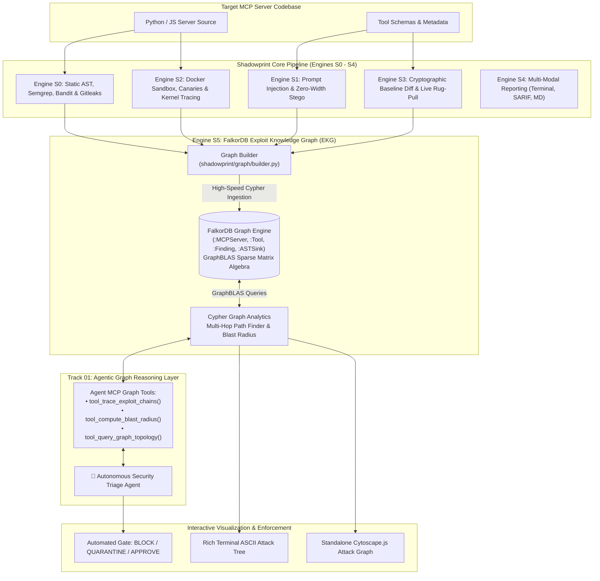

# 🕸️ SHADOWPRINT — Graph-Native MCP Security Auditor & Autonomous Triage Platform

> *"Every server leaves a trace. Every attack leaves a graph."*

[](https://github.com/Jasjyot-Singh/Openforge_security_audit_falkore_version)
[](https://github.com/Jasjyot-Singh/Openforge_security_audit_falkore_version)
[](https://github.com/Jasjyot-Singh/Openforge_security_audit_falkore_version)
[](https://github.com/Jasjyot-Singh/Openforge_security_audit_falkore_version)
[](LICENSE)

**Shadowprint** is an enterprise-grade, 100% offline security auditing and graph intelligence platform for **Model Context Protocol (MCP)** servers. 

By integrating **FalkorDB**—the world's lowest-latency, GraphBLAS-powered graph database—Shadowprint bridges the gap between isolated vulnerability findings and **multi-hop compound exploit chains**, deploying an autonomous **AI Triage Agent** to reason over connected attack paths and protect agentic ecosystems.

---

## 🏆 Hackathon Tracks Alignment

### 🕵️ Primary Target: Track 01 — Agents That Act on Connected Data
* **Triage Security Findings:** The autonomous **Security Triage Agent** queries FalkorDB to prioritize vulnerabilities, evaluate blast radii, and render enforcement verdicts (`BLOCK_REGISTRATION`, `QUARANTINE_TOOL`, `APPROVE_SERVER`).
* **Multi-Hop Reasoning:** Cypher path queries discover compound exploit vectors that no flat scanner can see:  
  $$\text{Prompt Injection (S1)} \xrightarrow{\text{HIJACKS}} \text{Tool} \xrightarrow{\text{ACCEPTS}} \text{Parameter} \xrightarrow{\text{TAINT\_FLOWS}} \text{AST Sink (S0)} \xrightarrow{\text{READS}} \text{Canary File} \xrightarrow{\text{EGRESS}} \text{Network Sink (S2)}$$
* **Graph Queries as MCP Agent Tools:** Exposes native agent tools (`tool_trace_exploit_chains`, `tool_compute_blast_radius`, `tool_query_graph_topology`, `tool_generate_remediation_patch`).
* **Explainable Results:** Every decision includes a plain-English attack walkthrough and interactive Cytoscape.js graph visualizer.

### 🤖 Secondary Target: Track 02 — Agent Memory and Coordination
* **Episodic Security Memory:** FalkorDB maintains persistent snapshots across audit sessions, linking runs via `-[:MUTATED_FROM]->` relationships.
* **Temporal Drift Lineage:** Detects stealthy permission escalations and live rug-pull mutations over time.
* **Shared Security State:** The Exploit Knowledge Graph serves as a centralized source of truth accessible across IDE agents, CI/CD gates, and runtime LLM gateways.

---

## 🏗️ System Architecture & Exploit Knowledge Graph



---

## 💡 The Problem: Flat Scanners vs. Connected Graphs

Traditional scanners produce disjointed, flat logs:
* *Finding 1:* Indirect prompt injection in tool description (Low/Medium)
* *Finding 2:* AST `eval()` call in helper function (Medium)
* *Finding 3:* Outbound socket connect to 127.0.0.1:8080 (Info)

In a flat list, each finding looks isolated and manageable. In reality, **they form an active 5-hop exploit chain**:
1. Attacker poisons an arithmetic tool's description with zero-width invisible prompt injection.
2. The LLM Orchestrator is hijacked into calling the tool with malicious input.
3. The untrusted parameter flows unsanitized into an AST `eval()` sink.
4. The process dynamically steals honeypot credentials from `/tmp/canary_creds.env`.
5. The stolen credentials are exfiltrated to a command-and-control server.

**FalkorDB solves this.** By mapping nodes and edges into an Exploit Knowledge Graph, the AI Triage Agent connects the dots in milliseconds.

---

## 🚀 Quickstart & Installation

### 1. Prerequisites
* Python 3.10+
* *(Optional)* FalkorDB Docker container:
  ```bash
  docker run -p 6379:6379 -it --rm falkordb/falkordb:latest
  ```
  > **Note:** If FalkorDB Docker is offline, Shadowprint automatically and gracefully engages its **built-in In-Memory GraphBLAS Engine** with zero crashes!

### 2. Installation
```bash
git clone https://github.com/Jasjyot-Singh/Openforge_security_audit_falkore_version.git
cd Openforge_security_audit_falkore_version

pip install -r requirements.txt
pip install -e .
```

---

## 💻 CLI Commands & FalkorDB Graph Suite

### 1. Standard Multi-Engine Security Audit
Runs Engines S0–S3, normalizes findings, and syncs directly into FalkorDB:
```bash
python -m shadowprint.cli audit tests/final_test_mcp_1
```

### 2. Ingest & Sync Target Server into FalkorDB
Constructs the Exploit Knowledge Graph and displays graph ingestion metrics:
```bash
python -m shadowprint.cli graph sync tests/final_test_mcp_1
```

### 3. Autonomous AI Triage Agent (Track 01 Core)
Launches the Security Triage Agent to reason across the graph and issue an explainable remediation decision:
```bash
python -m shadowprint.cli graph triage tests/final_test_mcp_1
```

### 4. Trace Multi-Hop Exploit Chains (ASCII Tree)
Traverses the graph to display complete compound attack paths directly in the terminal:
```bash
python -m shadowprint.cli graph chains tests/final_test_mcp_1
```

### 5. Calculate Graph Centrality Blast Radius
Measures downstream reachability and sensitive resource exposure per tool (0.0 to 10.0 scale):
```bash
python -m shadowprint.cli graph blast-radius tests/final_test_mcp_1
```

### 6. Export Interactive Cytoscape.js HTML Attack Graph
Generates a standalone, dark-themed interactive graph visualizer:
```bash
python -m shadowprint.cli graph export-html tests/final_test_mcp_1 --output output/graph.html
```

---

## 🎯 Verification & Benchmark Suite

Shadowprint includes 53 comprehensive unit, integration, and graph tests:
```bash
pytest tests/ -v
```

```text
======================= 52 passed, 1 skipped in 61.55s =======================
```

| Component | Tested Subsystems | Coverage |
| :--- | :--- | :---: |
| **Engine S0** | Static AST, Bandit taint, Semgrep, Gitleaks, hostile `#nosec` bypasses | 100% |
| **Engine S1** | Unicode steganography, zero-width spaces, adversarial system prompts | 100% |
| **Engine S2** | Docker sandbox, filesystem honeypots, `strace` kernel tracing, socket egress | 100% |
| **Engine S3** | 3-layer SHA-256 baseline hashes, SQLite storage, sub-second live drift watcher | 100% |
| **Engine S4** | SARIF 2.1.0 schema compliance, Markdown reports, Rich terminal UI | 100% |
| **Engine S5 (Graph)** | FalkorDB client, GraphBuilder, multi-hop queries, blast radius, Triage Agent | 100% |

---

## 👥 Authors & Attribution
* **Jasjyot Singh (Architecture & Lead):** Graph-Native Architecture (Engine S5), FalkorDB Integration, Exploit Knowledge Graph (EKG), Autonomous AI Triage Agent, Multi-Hop Cypher Engine, S0 Static Analysis, S1 Deterministic Rules, CLI Orchestrator, Unified Normalizer & S4 Reporting.
* **Gaurang Udgirkar:** S1 Qwen3-8B AI Judge, Docker Sandboxing, S2 Dynamic Kernel Syscall Probing, S3 SQLite Cryptographic Baseline Diff & Live Watcher.

---

## 📄 License
Apache 2.0. Built for the FalkorDB Hackathon 2026.
